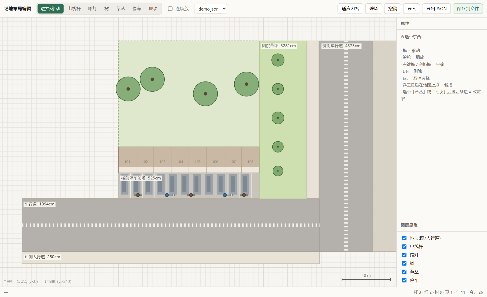

# satellite-to-layout

**Turn a satellite photo into a site layout you can drag around in a browser.**

给一张卫星图，换回来一份能拖、能拉边、能改数字的场地平面图。

Most "satellite → plan" attempts stop at an image. This one stops at **data + an editor**,
so the person who actually knows what the site should look like can adjust it themselves.



## What you get

```
satellite photo
      │  calibrate one known dimension (parking bay width is the most reliable)
      ▼
  layout.json          plain JSON, all centimetres, +x right / +y toward the street
      │  open in the editor
      ▼
  drag → pull edges → type exact numbers → save
      │  validate
      ▼
  hand off to whatever renders it (3D, drawing, construction doc)
```

The layout is bands of ground (`road` / `walk` / `curb` / `verge` / `lot` / `far`)
plus one building, trees, poles, lamps and cars. Nothing is baked into code,
so a different block is a different JSON file — not a code change.

## Quick start

```bash
# 1. how many centimetres is one pixel on your image?
python scripts/make_layout.py scale --px 235 --meters 29.12

# 2. generate a skeleton from real dimensions
python scripts/make_layout.py init --out site.json \
    --pattern corner --building-w 29.12 --building-d 5.40 --units 8 \
    --parking front --bays 11 --road 10.94

# 3. edit it in the browser
python scripts/layout_server.py --dir .
#   → http://127.0.0.1:8777/layout_editor.html

# 4. check it before shipping
python scripts/check_layout.py site.json
```

Zero dependencies. Python 3 standard library only. The editor is a single HTML file.

## Why the validator matters

The mistakes that hurt are the ones you **cannot see on a plan view**:

| Mistake | What it looks like |
|---|---|
| two bands at the same height overlap | the whole patch flickers in 3D (coplanar z-fighting) |
| a sidewalk laid across a roadway | only shows up when you stand on the street |
| a band narrower than 20 cm | silently dropped by a "bad data" filter — the curb disappears |
| a car 40 cm too far in | parked on the sidewalk |
| an object outside every band | floats in mid-air |

`check_layout.py` catches all of these from coordinates alone, and it was
itself tested with positive **and** negative controls — a validator that only
sees "healthy" input proves nothing.

## Documentation

- [`SKILL.md`](SKILL.md) — the full workflow, the JSON schema, the acceptance criteria
- [`references/real-world-dimensions.md`](references/real-world-dimensions.md) — bay widths, road widths, tree canopies
- [`references/calibration.md`](references/calibration.md) — pixel → centimetre, and why one reference is not enough
- [`references/pitfalls.md`](references/pitfalls.md) — eleven real failures, with symptoms and fixes
- [`assets/sample_layout.json`](assets/sample_layout.json) — a working example (8-unit block, corner site, 11 nose-in bays)

## Scope

Output is a **site plan**, not a building. It does not model walls, floors or structure —
it models where the ground, the parking, the green stuff and the street furniture are.

---

MIT. Built while turning an O'Connor (Canberra) corner block into an editable layout.
